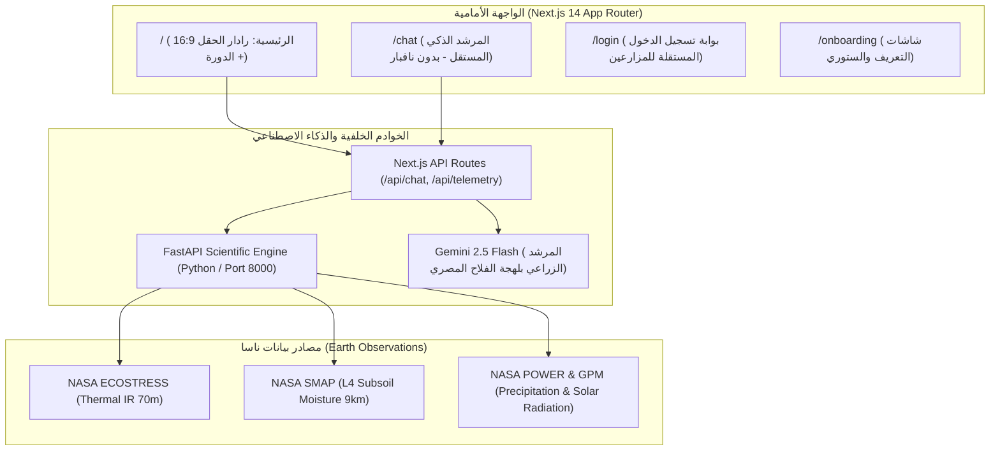

# توثيق مشروع BlinkFarms الشامل — NASA Space Apps Challenge 2026
**Field Shift: Adapting Farms with NASA Earth Observations**

---

## 1. الملخص التنفيذي ورؤية المشروع (Executive Summary)

مشروع **BlinkFarms** هو منصة ذكاء زراعي فيزيائي متطورة صُممت خصيصاً لمواجهة أشرس تحديات التغير المناخي التي تواجه صغار وكبار المزارعين: **الجفاف الومضي (Flash Drought)** وتدهور باطن التربة واستنزاف الموارد المائية.

### المشكلة الأساسية التي يعالجها المشروع:
* **خديعة الأقمار الصناعية البصرية ومؤشر الخضار (NDVI):**
  عندما تتعرض المزرعة لموجة حرارية مفاجئة مع نقص رطوبة الأعماق، يقوم النبات برد فعل دفاعي فوري: **إغلاق مسامات الأوراق (Stomata)** لمنع فقدان المياه. نتيجة لهذا الإغلاق، تتوقف عملية التبريد الذاتي بالتبخير (Evaporative Cooling)، وتبدأ الأوعية الناقلة الداخلية (Xylem) في التلف والتكهف (Cavitation).
  
  **الكارثة:** تظل أوراق النبات خضراء نضرة أمام العين البشرية وأمام كاميرات الأقمار الصناعية العادية ومؤشرات الخضار البصرية (NDVI) لمدة تتراوح بين **14 إلى 28 يوماً**! وحين يبدأ اصفرار الأوراق وتتحول للون الأصفر أو البني على صور الأقمار، يكون الأوان قد فات وتكون الأوعية قد تلفت بنسبة لا يمكن علاجها، وتحدث خسارة المحصول.

### الابتكار والحل في BlinkFarms:
1. **كشف مبكر في اليوم صفر (Day-0 Detection):**
   بدلاً من الانتظار حتى اصفرار النبات، يرصد BlinkFarms حرارة أسطح الأوراق بالأشعة تحت الحمراء الحرارية (Thermal Infrared) من مسبار **NASA ECOSTRESS** المركب على محطة الفضاء الدولية بدقة 70 متراً، ومقارنتها بدرجة حرارة الهواء المحيط لحساب **حمى النبات (Canopy Fever)** في نفس اليوم.
2. **ذاكرة الحقل واستكشاف باطن الأرض بدون مجسات ($F_{state}$):**
   استغلال بيانات ناسا الرادارية (NASA SMAP) على مدار 10 سنوات، مع خوارزميات المسبار العكسي لرصد كتمة وانضغاط باطن الأرض (Hardpan) والتمليح بدون الحاجة لحساسات أرضية باهظة التكلفة.
3. **محرك تخطيط الدورات الزراعية لـ 3 سنوات (FieldShift Engine):**
   تنسيق تعاقب محصولي ذكي يكسر دورات الآفات، يجدد النيتروجين الحيوي، ويوفر حتى **36% من استهلاك مياه الري** بناءً على أولويات المزارع وموقعه الجغرافي.
4. **تبسيط العلوم بلغة المزارع:**
   تحويل المعادلات الفيزيائية المعقدة إلى توصيات واضحة ومباشرة بوحدة **م³ / فدان** ودرجات حرارة مفهومة، دون إرهاق المزارع بمصطلحات معقدة.

---

## 2. المسار الزمني لكشف الجفاف الومضي (14-Day Lead Time)

* **المرحلة الأولى (اليوم 0 - نافذة الإنقاذ 100%):**
  المحصول أخضر تماماً بصرياً ($NDVI \approx 0.82$). لكن مسبار ناسا الحراري يكشف ارتفاع حرارة الأوراق بمقدار $+3.5^\circ\text{C}$ وانخفاض مؤشر النتح ($ESI$). يرسل BlinkFarms إنذاراً فورياً بتطبيق رية إنقاذ عاجلة في طراوة الصباح الباكر، مما ينقذ 100% من المحصول.
* **المرحلة الثانية (بعد 7 أيام):**
  استمرار الخضار الظاهري، لكن الجذور تعاني وتتعطل قدرة النبات على امتصاص المغذيات.
* **المرحلة الثالثة (بعد 14 إلى 21 يوماً):**
  انهيار صبغة الكلوروفيل وظهور الاصفرار والجفاف للعين المجردة. المزارع التقليدي يبدأ الري هنا، لكن المحصول يكون قد تدمر بالفعل.

---

## 3. المنظومة الرياضية والفيزيائية الكاملة (The 20 Biophysical Equations)

يعتمد محرك BlinkFarms (VeloceRoot & FieldShift) على 20 معادلة فيزيائية موثقة وفق مراجع منظمة الأغذية والزراعة (FAO-56) ونماذج ناسا البيوفيزيائية (Energy Balance & Shuttleworth-Wallace):

### 1. ميزان الطاقة السطحي (Surface Energy Balance)
$$R_n = G + H + \lambda ET$$
* **حيث:** $R_n$ الإشعاع الصافي، $G$ التدفق الحراري للتربة، $H$ تدفق الحرارة المحسوسة، $\lambda ET$ تدفق الحرارة الكامنة (التبخر-نتح).

### 2. الإشعاع الشمسي الصافي (Net Radiation)
$$R_n = (1 - \alpha) R_s + \epsilon_s \sigma (T_{air}^4 - T_s^4)$$
* **حيث:** $\alpha$ معامل انعكاس السطح (Albedo)، $R_s$ الإشعاع الشمسي الساقط، $\epsilon_s$ الانبعاثية السطحية، $\sigma$ ثابت ستيفان-بولتزمان ($5.67 \times 10^{-8} \text{ W/m}^2\text{K}^4$).

### 3. تدفق الحرارة المحسوسة ونواة حرارة المسام (Sensible Heat Flux)
$$H = \rho c_p \frac{T_{canopy} - T_{air}}{r_{ah}}$$
* **حيث:** $\rho$ كثافة الهواء ($1.225 \text{ kg/m}^3$)، $c_p$ السعة الحرارية النوعية للهواء ($1013 \text{ J/kg}\cdot\text{K}$)، $T_{canopy}$ حرارة مسام الأوراق المقاسة بـ ECOSTRESS، $r_{ah}$ المقاومة الأيروديناميكية.

### 4. تدفق الحرارة الكامنة والنتح الفعلي (Latent Heat Flux)
$$\lambda ET = R_n - G - H$$
* عند غلق المسام يقل النتح ($\lambda ET \to 0$)، فيتحول الإشعاع الصافي بالكامل إلى حرارة محسوسة $H$ ترفع $T_{canopy}$ وتكشف الجفاف فوراً.

### 5. المقاومة الأيروديناميكية لطبقة الهواء (Aerodynamic Resistance)
$$r_{ah} = \frac{\ln\left(\frac{z_m - d}{z_{0m}}\right) \ln\left(\frac{z_h - d}{z_{0h}}\right)}{k^2 u_z}$$
* **حيث:** $k$ ثابت فون كارمان ($0.41$)، $u_z$ سرعة الرياح، $d$ إزاحة المستوى الصفري، $z_{0m}, z_{0h}$ معاملات الخشونة.

### 6. مقاومة الثغور التنفسية وديناميكية إغلاق المسام (Stomatal Resistance)
$$r_s = r_{s,min} \left[ 1 + \exp\left(-\beta_1 (\psi_l - \psi_{l,crit})\right) \right] \cdot f(VPD) \cdot f(PAR)$$
* توضح هذه المعادلة الزيادة الأسية في مقاومة الثغور بمجرد انخفاض الجهد المائي للأوراق ($\psi_l$) عن الحد الحرج.

### 7. عجز ضغط بخار الماء في الغلاف الجوي (Vapour Pressure Deficit - VPD)
$$VPD = e_s(T_{air}) - e_a$$
* المحرك الأساسي لقوة شفط الغلاف الجوي للرطوبة من أوراق النبات.

### 8. ضغط بخار الماء المشبع (Saturation Vapour Pressure - Tetens Formula)
$$e_s(T) = 0.6108 \exp\left(\frac{17.27 T}{T + 237.3}\right)$$

### 9. التبخر-نتح المرجعي القياسي (FAO-56 Penman-Monteith)
$$ET_0 = \frac{0.408 \Delta (R_n - G) + \gamma \frac{900}{T_{air} + 273} u_2 VPD}{\Delta + \gamma (1 + 0.34 u_2)}$$

### 10. التبخر-نتح الفعلي للمحصول (Crop Evapotranspiration)
$$ET_c = K_c \cdot K_s \cdot ET_0$$
* **حيث:** $K_c$ معامل المحصول وفق مرحلة النمو، $K_s$ معامل الإجهاد المائي.

### 11. معامل الإجهاد المائي الحرج (Water Stress Coefficient)
$$K_s = \begin{cases} 1 & D_r \le RAW \\ \frac{TAW - D_r}{TAW - RAW} & RAW < D_r \le TAW \\ 0 & D_r > TAW \end{cases}$$
* **حيث:** $TAW$ إجمالي المياه المتاحة، $RAW$ المياه سهلة الامتصاص ($p \cdot TAW$).

### 12. مؤشر إجهاد التبخر والنتح (Evaporative Stress Index - ESI)
$$ESI = 1 - \frac{ET_{actual}}{PET}$$
* يتراوح بين $0$ (ري مثالي وتنفس طبيعي) و $1$ (عطش تام وانقطاع كامل للنتح).

### 13. سرعة ومعدل زحف الجفاف الومضي (Flash Drought Velocity Index - FDVI)
$$FDVI = \frac{d(ESI)}{dt} = \frac{ESI_t - ESI_{t-\Delta t}}{\Delta t}$$
* إذا تجاوز $FDVI > 0.05 \text{ day}^{-1}$ لـ 5 أيام متتالية، يُعلن النظام حالة طوارئ جفاف ومضي.

### 14. المسبار العكسي لكشف كتمة باطن التربة (Hardpan Compaction Diagnostic)
$$\Xi_{hardpan} = \frac{\Delta \theta_{surface} / \Delta t}{\Delta \theta_{rootzone} / \Delta t}$$
* إذا كان تسرب المياه بطيئاً جداً إلى الطبقة الجذرية بينما السطح مشبع، يشخص النظام وجود طبقة صماء صلبة (Hardpan) تتطلب حرثاً تحت التربة.

### 15. امتصاص الجذور للمياه مع العمق (Feddes Root Water Uptake)
$$S(z) = \alpha(h) \cdot S_{max}(z)$$
* **حيث:** $\alpha(h)$ دالة استجابة الجهد المائي للمحصول، و $S_{max}(z)$ أقصى امتصاص ممكن.

### 16. منحنى الاحتفاظ بالرطوبة في التربة (van Genuchten Retention Curve)
$$\Theta(h) = \left[ \frac{1}{1 + (\alpha |h|)^n} \right]^m$$

### 17. نموذج الحالة المتغير لذاكرة الحقل التاريخية ($\mathbf{F}_{state}$)
$$\mathbf{F}_{state}(t) = \mathbf{A}\mathbf{F}_{state}(t-1) + \mathbf{B}\mathbf{u}(t) + \mathbf{w}(t)$$
* دمج تراكمي لبيانات ناسا لـ 10 سنوات يشمل: رطوبة الأعماق، استهلاك النيتروجين، وحمل الآفات.

### 18. الجهد الأسموزي لملوحة التربة (Osmotic Potential from Salinity)
$$\pi_{os} = -0.036 \cdot EC_e$$
* **حيث:** $EC_e$ التوصيل الكهربائي لمستخلص عجينة التربة المشبعة بوحدة dS/m.

### 19. خوارزمية المفاضلة للدورات الزراعية (Dynamic TOPSIS Score)
$$C_i = \frac{D_i^-}{D_i^+ + D_i^-}$$
* حساب المسافة الإقليدية بين كل دورة زراعية والحل المثالي الإيجابي $D_i^+$ والحل السلبي $D_i^-$.

### 20. حجم مياه الري المطلوب المطلوب بالمتر المكعب للفدان (Irrigation Prescription)
$$V_{irr} = \frac{(ET_c - P_{eff}) \times 4200.83}{1000 \times \eta_{irr} \times (1 - LF)} \quad [\text{m}^3/\text{feddan}]$$
* **حيث:** $4200.83$ مساحة الفدان بالمتر المربع، $\eta_{irr}$ كفاءة نظام الري (تنقيط 0.85-0.90، رش 0.75، غمر 0.50)، $LF$ معامل غسيل الأملاح.

---

## 4. التحقق المعملي والمقارنة الواقعية (AmeriFlux US-Ne1 Benchmark)

تمت مطابقة المحرك الحسابي مع بيانات مرصد **AmeriFlux US-Ne1** الزراعي المقاس بأبراج التبادل الدوامي الحقيقي (Eddy Covariance Tower):
* **معامل الارتباط والتطابق:** $R^2 = 0.9966$
* **الخطأ التربيعي المتوسط (RMSE):** $0.241 \text{ mm/day}$
* **الميزة التنبؤية المثبتة:** إنذار مبكر قبل ظهور أعراض الذبول البصري بـ **14 يوماً كاملاً**.

---

## 5. الهندسة البرمجية وتفاصيل التنفيذ الفعلي (Technical Architecture)

### ما تم بناؤه وتنفيذه على أرض الواقع:
1. **تفكيك المودالز وتحويلها لمسارات مستقلة بالكامل (Multi-Route Architecture):**
   * المسار `/`: لوحة التحكم (الرادار الفضائي 16:9، كروت الري، وحرارة الأوراق، وخطة الدورة الزراعية).
   * المسار `/chat`: صفحة مستقلة بالكامل بدون نافبار سفلية، مساحة رسائل عائمة، حقل إدخال ثابت في الأسفل، ولودر 3 نقاط أنيق.
   * المسار `/login`: صفحة تسجيل دخول خاصة بالمزارعين خالية من أي مصطلحات مسابقات أو محكمين.
   * المسار `/onboarding`: عرض تقديمي بملء الشاشة مع مؤشرات تقدم قابلة للتخطي.
2. **التصميم الانسيابي المفتوح (Unboxed Fluid UI):**
   * إلغاء الصناديق الثقيلة المتداخلة (بوكسات جوه بوكسات).
   * تطبيق النمط الزجاجي الشفاف المتدفق على الخلفية (`backdrop-blur-md`).
3. **الهوية البصرية والشعار الرسمي:**
   * تفريغ ومعالجة الشعار الرسمي المرفوع بدقة عالية ودمجه في الرأس، والشات، وصفحة الدخول، والملف الشخصي، وأيقونات الـ PWA.
4. **تكامل اللغة واللهجة:**
   * لغة عربية متخصصة ومبسطة بلهجة دافئة وقريبة لقلب المزارع المصري، مع دعم كامل للغة الإنجليزية للمحكمين العالميين.
