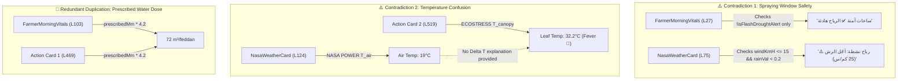
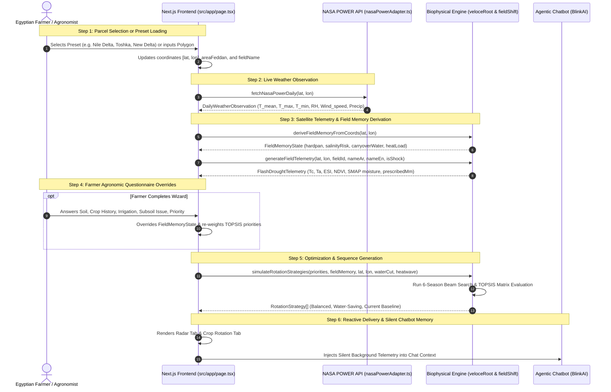

# Comprehensive Technical Audit & Architectural Blueprint: Field Radar & Crop Rotation (FieldShift)

> **Document ID:** `BF-AUDIT-2026-V2`  
> **Classification:** Technical Architecture & Agronomic UX Audit  
> **Project:** BlinkFarms (FieldShift) — NASA Space Apps Challenge 2026 (Challenge 7)  
> **Authors:** Principal Agronomic Systems Architect & Lead UX Auditor  
> **Status:** Completed Read-Only Audit & Specification  
> **Target Date:** November 2026  

---

## Executive Summary

This document delivers a forensic, code-level architectural audit and biophysical evaluation of the two core operational screens of **BlinkFarms**:
1. **The Main Field Radar / Home Dashboard** (`الرئيسية / رادار الحقل` — `src/app/page.tsx`, `FarmerMorningVitals.tsx`, `NasaWeatherCard.tsx`, Action Cards 1–3, `DroughtThreatGauge.tsx`, `SplitFieldMap.tsx`)
2. **The Smart Crop Rotation Page** (`الدورة الزراعية / FieldShift` — `src/app/page.tsx`, `CropRotationPlanner.tsx`, `AgronomicWizard.tsx`, `fieldShiftEngine.ts`, `veloceRootEngine.ts`, `cropDatabase.ts`)

While BlinkFarms possesses an exceptionally strong scientific foundation—integrating satellite missions (NASA POWER, ECOSTRESS, SMAP L4, Landsat/Sentinel-2 HLS) with FAO-56 Penman-Monteith, FAO AquaCrop, and DSSAT sequence modeling—the current implementation suffers from **severe UI component redundancies, jarring logical contradictions across adjacent cards, uncontextualized physical metrics, and a critical lack of localized Egyptian agronomic operational parameters** (such as official cultivars, ardeb/feddan units, and phased NPK fertilization schedules).

This audit identifies every single visual element, breaks down every underlying mathematical model, exposes all contradictions with line-numbered proof, catalogs the crop knowledge base, maps data pipelines, and proposes a unified, production-grade TypeScript contract for the V2 rebuild.

---

## 1. Component & Visual Hierarchy Inventory (Current State)

### 1.1 Screen 1: The Main Field Radar / Home Dashboard (`الرئيسية`)

The home tab (`activeTab === 'radar'`) is structured inside `src/app/page.tsx` (Lines 420–614) as a vertical stack of 5 major visual sections:

```
┌─────────────────────────────────────────────────────────────────┐
│ 1. SplitFieldMap & Field Preset Selector                        │
│    (src/components/SplitFieldMap.tsx & src/app/page.tsx:422-440)│
├─────────────────────────────────────────────────────────────────┤
│ 2. FarmerMorningVitals (Daily Morning Vitals - 4 Cards Grid)    │
│    (src/components/FarmerMorningVitals.tsx & page.tsx:443-447)  │
│    [Thirst & Stomata] [Today's Dose] [Spray Window] [Subsoil]   │
├─────────────────────────────────────────────────────────────────┤
│ 3. NasaWeatherCard (NASA POWER 4 Cards Grid)                    │
│    (src/components/NasaWeatherCard.tsx & page.tsx:449-451)      │
│    [Temperature] [Spray & Wind] [Humidity & Dew] [Rain & Irrig] │
├─────────────────────────────────────────────────────────────────┤
│ 4. The 3 Essential Action Cards                                 │
│    (src/app/page.tsx:453-608)                                   │
│    [Card 1: Prescribed Irrigation] [Card 2: Leaf Temp] [Card 3] │
├─────────────────────────────────────────────────────────────────┤
│ 5. DroughtThreatGauge (Real-Time Drought Threat Gauge)          │
│    (src/components/DroughtThreatGauge.tsx & page.tsx:610-612)   │
└─────────────────────────────────────────────────────────────────┘
```

#### Detailed Component Inspection

| # | Component / Sub-card | File & Line Reference | Data & State Variables Read | Status / Color / Threshold Logic | Duplication / Contradiction Issue |
|---|---|---|---|---|---|
| **1.1** | **Field Preset Selector & Boundary** | `src/app/page.tsx#L422-L440`, `SplitFieldMap.tsx#L1-L150` | `DEMO_FIELDS`, `selectedFieldId`, `currentFieldName`, `currentAreaFeddan`, `coordinates` | Active pill styled with blue ring; toggles selected demo parcel. | Displays field name, crop, and feddans cleanly. No contradiction. |
| **1.2** | **Vital 1: Crop Thirst & Stomata** | `FarmerMorningVitals.tsx#L17-L20, L55-L90` | `telemetry.isFlashDroughtAlert`, `telemetry.canopyTempAnomalyC` | **Red (Early Stress):** `isFlashDroughtAlert \|\| canopyTempAnomalyC > 1.8`<br>**Green (Hydrated):** `canopyTempAnomalyC <= 1.0`<br>**Yellow:** otherwise | Partially overlaps with Action Card 3 (`currentESI`) and `DroughtThreatGauge`. |
| **1.3** | **Vital 2: Today's Irrigation Dose** | `FarmerMorningVitals.tsx#L21-L25, L92-L115` | `telemetry.prescribedIrrigationMm`, `areaFeddan` | `m3PerFeddan = Math.round(prescribedMm * 4.2)`<br>`totalFieldM3 = Math.round(m3PerFeddan * areaFeddan)` | **BLATANT 100% DUPLICATION:** Directly above Action Card 1 (`page.tsx#L454-L502`) which shows the exact same `~{Math.round(prescribedIrrigationMm * 4.2)} m³/feddan`. |
| **1.4** | **Vital 3: Foliar Spray Window** | `FarmerMorningVitals.tsx#L26-L28, L117-L143` | `telemetry.isFlashDroughtAlert` | **Safe (Green):** `!telemetry.isFlashDroughtAlert`<br>**Delay (Yellow):** `telemetry.isFlashDroughtAlert` | **CRITICAL CONTRADICTION:** Declares spray window "Safe / Calm winds" based solely on drought alert, ignoring real wind speed! Directly contradicts `NasaWeatherCard` below it. |
| **1.5** | **Vital 4: Subsoil Moisture (SMAP)** | `FarmerMorningVitals.tsx#L29-L31, L144-L170` | `telemetry.rootZoneMoistureMm` | `rootMoisturePct = Math.min(100, Math.round((rootZoneMoistureMm / 70) * 100))`<br>**Green text:** `rootMoisturePct > 45` | Overlaps with Subsoil Condition cards on the Rotation page. |
| **1.6** | **Weather 1: Ambient Temperature** | `NasaWeatherCard.tsx#L65-L78, L114-L139` | `obs.t_air_mean_c.value`, `t_air_max_c.value`, `t_air_min_c.value` | **Heatwave (Red):** `tempMax >= 36`<br>**Frost (Blue):** `tempMin <= 6`<br>**Optimal (Green):** otherwise | **COGNITIVE DISSONANCE:** Shows ambient temperature (e.g. 19°C), while Action Card 2 below it shows Leaf Temperature 32.2°C without explanation! |
| **1.7** | **Weather 2: Spray Safety & Wind** | `NasaWeatherCard.tsx#L70-L75, L141-L162` | `obs.wind_speed_ms.value * 3.6` (`windKmH`), `obs.precipitation_mm.value` (`rainVal`) | **Safe (Green):** `windKmH <= 15 && rainVal < 0.2`<br>**Windy (Yellow):** `windKmH > 15 \|\| rainVal >= 0.2` | **CRITICAL CONTRADICTION:** When wind is 24 km/h, this card says `⚠️ رياح نشطة: أجّل الرش`, while `FarmerMorningVitals` (Card 1.4) says `✅ ساعات آمنة: الرياح هادئة`! |
| **1.8** | **Weather 3: Humidity & Dew** | `NasaWeatherCard.tsx#L69, L164-L187` | `obs.rh_pct.value` (`rhVal`) | **High Dew (Amber):** `rhVal > 75`<br>**Optimal (Blue):** `rhVal <= 75` | Good agronomic value (fungal risk monitoring). |
| **1.9** | **Weather 4: Rain & Irrigation** | `NasaWeatherCard.tsx#L72, L189-L215` | `obs.precipitation_mm.value` (`rainVal`) | Displays rainfall in mm. Advises whether rainfall offsets irrigation. | Sound logic. |
| **1.10** | **Action Card 1: Prescribed Irrigation** | `src/app/page.tsx#L454-L502` | `telemetry.prescribedIrrigationMm`, `telemetry.isFlashDroughtAlert` | Displays `~Math.round(prescribedIrrigationMm * 4.2) m³/feddan`. Mode badge: **Urgent Quenching (Red)** vs **Routine Maintenance (Green)**. | **REDUNDANT DUPLICATION:** Exactly mirrors Vital Card 2 (`FarmerMorningVitals`). |
| **1.11** | **Action Card 2: Crop Leaf Temperature** | `src/app/page.tsx#L504-L554` | `telemetry.canopyTempC` | **Cool (Green):** `<= 28°C`<br>**Warm (Yellow):** `> 28 && <= 33°C`<br>**Fever (Red):** `> 33°C` | Confuses farmers when NASA air temp is 19°C. Missing $\Delta T = T_c - T_a$ differential context. |
| **1.12** | **Action Card 3: Plant Transpiration & Respiration** | `src/app/page.tsx#L556-L608` | `telemetry.currentESI` | **Active / Healthy (Green):** `currentESI >= 0.70`<br>**Early Stress (Yellow):** `0.50 <= currentESI < 0.70`<br>**Severe Closure (Red):** `currentESI < 0.50` | Duplicates Vital Card 1 (`عطش الغيط وتنفس النبات`). |
| **1.13** | **Drought Threat Gauge** | `DroughtThreatGauge.tsx#L18-L140` | `telemetry.isFlashDroughtAlert`, `telemetry.canopyTempAnomalyC`, `telemetry.currentESI` | **Level 3 Alert (Red):** `isFlashDroughtAlert \|\| anomaly >= 2.5`<br>**Level 2 Watch (Amber):** `anomaly > 1.0 \|\| currentESI < 0.70`<br>**Level 1 Normal (Green):** default | Rich 3-stage bar, but repeats information already stated in Vitals 1, Action 2, and Action 3. |

---

### 1.2 Screen 2: The Smart Crop Rotation Page (`الدورة الزراعية`)

The rotation tab (`activeTab === 'rotation'`) in `src/app/page.tsx` (Lines 618–730) renders:

```
┌─────────────────────────────────────────────────────────────────┐
│ 1. Wizard Completed / Recalibration Banner (page.tsx:630-649)   │
├─────────────────────────────────────────────────────────────────┤
│ 2. Subsoil Health Insights (3 Plain Cards Grid, page.tsx:651-707)│
│    [1. Subsoil Condition] [2. Deep Moisture] [3. Soil Salinity]  │
├─────────────────────────────────────────────────────────────────┤
│ 3. CropRotationPlanner (src/components/CropRotationPlanner.tsx) │
│    ├─ Goal Selector: 3 Strategy Cards (Balanced / Water / Current│
│    ├─ Immediate Next Crop Banner (What do I plant next?)        │
│    ├─ 3-Year / 6-Season Succession Timeline (6 click cards)     │
│    ├─ Selected Season Deep-Dive Card                            │
│    ├─ 3 Total Gain Cards (Water Saved, Urea Saved, Bio-Drilling)│
│    └─ Collapsible NASA Climate Stress Simulator (Sliders)       │
└─────────────────────────────────────────────────────────────────┘
```

#### Detailed Component Inspection

| # | Component / Sub-card | File & Line Reference | Data & State Variables Read | Status / Color / Threshold Logic | Duplication / Contradiction Issue |
|---|---|---|---|---|---|
| **2.1** | **Wizard Recalibrate Strip** | `src/app/page.tsx#L630-L649` | `isWizardCompleted`, `currentAreaFeddan` | Action button resets `blinkfarms_wizard_completed` to re-trigger questionnaire. | Clean, functional. |
| **2.2** | **Subsoil Condition Card** | `src/app/page.tsx#L671-L682` | `fieldMemory.hardpanDetected` | `hardpanDetected === true` warns of subsoil compaction (requires chisel plow); `false` indicates optimal permeability. | **DUPLICATION:** Repeats the "Subsoil Bio-Drilling" card inside `CropRotationPlanner#L349-L364`. |
| **2.3** | **Deep Moisture Card** | `src/app/page.tsx#L684-L694` | `fieldMemory.carryoverWaterFraction` | `>= 0.50` indicates good deep reserve (Green); `< 0.50` indicates deficit (Yellow). | Overlaps with SMAP root-zone moisture on the Main Dashboard. |
| **2.4** | **Soil Salinity Card** | `src/app/page.tsx#L696-L706` | `fieldMemory.salinityRiskLevel` | `'moderate' \|\| 'severe'` recommends gypsum / soil conditioners (Red); `'normal'` displays safe (Green). | Static snapshot; does not show dynamic seasonal leaching. |
| **2.5** | **Goal Switcher (3 Strategies)** | `CropRotationPlanner.tsx#L88-L153` | `strategies[]`, `selectedStrategyId` | Highlights selected strategy in solid emerald background. Shows badge: Recommended ⭐, Water-Saving 38%, Baseline ⚠️. | High UX clarity and easy 1-click interaction. |
| **2.6** | **Immediate Next Crop Banner** | `CropRotationPlanner.tsx#L156-L204` | `allSeasons[0].season` | Displays recommended crop name, botanical family, agronomic justification, water requirement in m³/feddan, and urea bags saved. | High farmer utility, but water need uses generic formula `m3Ha * 0.42` rather than localized irrigation efficiency. |
| **2.7** | **6-Season Timeline Badges** | `CropRotationPlanner.tsx#L207-L271` | `allSeasons[]` (6 items) | Blue badges for Winter seasons, Amber for Summer. Displays active selection ring, crop name, water m³/feddan, and N-fixation indicator. | Very effective visual sequence; needs calendar sowing months. |
| **2.8** | **Selected Season Deep-Dive** | `CropRotationPlanner.tsx#L274-L314` | `allSeasons[activeSeasonIndex]` | Displays season index, year, crop family, water requirement, net margin estimate, and plain agronomic reason (`transitionReasonAr`). | Missing cultivar names, seed rate, and stage-by-stage fertilization. |
| **2.9** | **Total 3-Year Gains (3 Cards)** | `CropRotationPlanner.tsx#L317-L364` | `activeStrategy.totalWaterSavedM3Feddan`, `totalUreaBagsSavedPerFeddan`, `biodrillingRemediated` | **Card 1:** Net Water Saved in m³/feddan & %<br>**Card 2:** Urea Bags Saved per feddan & EGP financial savings<br>**Card 3:** Bio-drilling status | **DUPLICATION with Section 2.2–2.4:** Both sections report hardpan and soil condition independently. |
| **2.10**| **Climate Stress Simulator** | `CropRotationPlanner.tsx#L367-L451` | `whatIfWaterCutPercent`, `whatIfHeatwaveC` | Slider 1 (0 to 30% water cut); Slider 2 (0 to +4°C heatwave). Dynamically re-runs beam search optimizer. | Exceptional scientific tool for demonstration, but buried in a sub-accordion. |

---

### 1.3 Consolidated Inventory of Contradictions & Redundancies



1. **The Spraying Window Paradox:**
   - In `FarmerMorningVitals.tsx#L27`: `const isSpraySafe = !telemetry.isFlashDroughtAlert;`
   - In `NasaWeatherCard.tsx#L75`: `const isSpraySafe = windKmH <= 15 && rainVal < 0.2;`
   - *Impact:* On a windy day (e.g. 25 km/h) without drought alert, the farmer sees two conflicting cards on the same screen: one urging them to spray immediately because "winds are calm", and one directly below warning that winds will cause chemical drift and pesticide waste!
2. **The Canopy Fever Disconnect:**
   - In `NasaWeatherCard.tsx#L124`: Displays ambient air temperature $T_a \approx 19^\circ\text{C}$.
   - In `src/app/page.tsx#L519`: Displays canopy temperature $T_c \approx 32.2^\circ\text{C}$ with a red "Fever" alert.
   - *Impact:* A farmer or agricultural engineer looking at both cards sees a 13.2°C difference without explanation. While plant physiologists understand that stomatal closure under water stress shuts down evaporative cooling causing canopy heat buildup, the UI does not display $\Delta T = T_c - T_a$ or connect the two measurements.
3. **Stacked 72 m³/feddan Duplication:**
   - `FarmerMorningVitals` Vital Card 2 renders `Math.round(telemetry.prescribedIrrigationMm * 4.2)`.
   - Action Card 1 (directly below it) renders `~Math.round(telemetry.prescribedIrrigationMm * 4.2)`.
   - *Impact:* Takes up prime mobile viewport real estate to state the exact same prescription twice.
4. **Subsoil Telemetry Fragmentation:**
   - Root-zone moisture is shown on the Main Radar page in mm and % (`FarmerMorningVitals#L148`).
   - Deep moisture is shown on the Crop Rotation page as a qualitative statement (`page.tsx#L684`).
   - Hardpan compaction is diagnosed on the Crop Rotation page (`page.tsx#L671`) and again in `CropRotationPlanner#L349`.
   - *Impact:* Fragmented diagnostics across pages instead of an integrated Soil & Water Profile.

---

## 2. Complete Mathematical & Biophysical Engine Breakdown

All biophysical calculations across BlinkFarms are executed either in TypeScript on the frontend (`src/lib/veloceRootEngine.ts`, `src/lib/fieldShiftEngine.ts`) or replicated inside the Python FastAPI service (`blinkfarms/engine_py/api_server.py`).

### 2.1 Main Dashboard Biophysical Equations

#### A. Evaporative Deficit & Prescribed Irrigation Depth ($I_{req}$)
Located in `src/lib/veloceRootEngine.ts#L317-L320` and `FarmerMorningVitals.tsx#L21-L24`:

$$\text{prescribedMm} = \begin{cases} 
35.0 + 2.5 \cdot |\Delta T_c| & \text{if } \text{isFlashDroughtAlert} = \text{true} \\
16.0 + 4.0 \cdot \mathcal{U}(0, 1) & \text{if normal operating condition}
\end{cases}$$

Conversion from millimeter water depth to cubic meters per Egyptian feddan:
$$V_{\text{feddan}} (\text{m}^3/\text{fed}) = I_{req} (\text{mm}) \times 4.20083$$

*Mathematical Derivation:*
$$1\text{ Egyptian Feddan} = 4,200.833\text{ m}^2$$
$$1\text{ mm depth} = 10^{-3}\text{ m}$$
$$V = 4,200.833\text{ m}^2 \times 0.001\text{ m} = 4.20083\text{ m}^3 \approx 4.2\text{ m}^3$$
*Code Reference:* `Math.round(prescribedMm * 4.2)` in `FarmerMorningVitals.tsx#L23`.

#### B. Canopy Temperature & Thermal Anomaly ($\Delta T$)
Located in `src/lib/veloceRootEngine.ts#L251-L310`:

$$T_{\text{canopy, healthy}} = T_{\text{air, baseline}} - 2.5^\circ\text{C}$$

Under normal conditions with adequate transpiration, latent heat flux ($\lambda E$) cools the leaf surface below ambient air temperature:
$$T_c = T_{\text{canopy, healthy}} + \Delta_{\text{aridity}} + 0.7 \cdot \sin(0.22 \cdot \text{day} + \phi)$$

During flash drought (stomatal shutdown):
$$T_c(t) = T_{\text{canopy, healthy}} + 1.5 + 5.2 \cdot \left(\frac{t - 14}{14}\right)$$
$$\Delta T = T_c - T_{\text{air, baseline}}$$

*Threshold Logic (`FarmerMorningVitals.tsx#L18`):*
- $\Delta T \le 1.0^\circ\text{C} \implies$ **Optimal Hydration (Green)**
- $1.0^\circ\text{C} < \Delta T \le 1.8^\circ\text{C} \implies$ **Early Watch (Yellow)**
- $\Delta T > 1.8^\circ\text{C} \implies$ **Crop Thirst / Stomatal Resistance Spike (Red)**

#### C. Evaporative Stress Index (ESI) & Flash Drought Acceleration
Located in `src/lib/veloceRootEngine.ts#L267-L309`:

$$\text{ESI} = 1.0 - \frac{\text{ET}_{\text{actual}}}{\text{PET}} \quad \text{or standardized ratio } \frac{\text{ET}}{\text{PET}}$$

In BlinkFarms telemetry, ESI is scaled from 0.0 (maximum stress) to 1.0 (unrestricted potential transpiration):
$$\Delta \text{ESI}_{7d} = \text{ESI}(t) - \text{ESI}(t - 7)$$

*Flash Drought Trigger Condition (`veloceRootEngine.ts#L312`):*
$$\text{Alert} = \text{simulateShock} \land (\text{ESI}(t) < 0.45 \lor \Delta T > 1.5^\circ\text{C})$$

*The 14-Day Early Warning Lead Time:*
During days $14 \le t \le 28$, ESI collapses from $0.76 \to 0.30$ and $T_c$ rises $+5^\circ\text{C}$, while optical greenness ($\text{NDVI}$) stays deceptively flat ($0.81 \to 0.79$) because chlorophyll degradation lags cellular desiccation by 10–14 days.

#### D. Root-Zone Soil Moisture (SMAP 30m Downscaled)
Located in `src/lib/veloceRootEngine.ts#L334`:

$$\theta_{\text{root}} = \begin{cases} 38.0\text{ mm} & \text{if flash drought active} \\ 88.0\text{ mm} & \text{if normal operating condition} \end{cases}$$
$$\text{rootMoisturePct} = \min\left(100, \text{round}\left(\frac{\theta_{\text{root}}}{70.0} \times 100\right)\right)$$

---

### 2.2 Crop Rotation & FieldShift Engine Equations

#### A. Multi-Criteria TOPSIS Solver
Located in `src/lib/fieldShiftEngine.ts#L29-L91`. Evaluates candidate 6-season rotation sequences across 4 criteria:
1. $C_1$: 3-Year Net Profit ($\text{USD/ha}$) — **Benefit Criterion**
2. $C_2$: 3-Year Water Saved ($\%$) — **Benefit Criterion**
3. $C_3$: Soil Health Index ($0 - 100$) — **Benefit Criterion**
4. $C_4$: Average Failure Risk ($\%$) — **Cost Criterion**

*Step 1: Vector Normalization*
$$r_{ij} = \frac{x_{ij}}{\sqrt{\sum_{k=1}^m x_{kj}^2}}, \quad \forall j \in \{1, 2, 3, 4\}$$

*Step 2: Weighted Normalized Decision Matrix*
$$v_{ij} = r_{ij} \times w_j, \quad \text{where } \sum_{j=1}^4 w_j = 1.0$$
*(Default weights: $w_{\text{profit}} = 0.25, w_{\text{water}} = 0.35, w_{\text{soil}} = 0.25, w_{\text{risk}} = 0.15$)*

*Step 3: Ideal Solutions*
$$A_j^+ = \begin{cases} \max_i(v_{ij}) & \text{if } j \in \{1, 2, 3\} \\ \min_i(v_{ij}) & \text{if } j = 4 \end{cases}$$
$$A_j^- = \begin{cases} \min_i(v_{ij}) & \text{if } j \in \{1, 2, 3\} \\ \max_i(v_{ij}) & \text{if } j = 4 \end{cases}$$

*Step 4: Euclidean Separation Distances & Closeness Coefficient*
$$S_i^+ = \sqrt{\sum_{j=1}^4 (v_{ij} - A_j^+)^2}, \quad S_i^- = \sqrt{\sum_{j=1}^4 (v_{ij} - A_j^-)^2}$$
$$C_i^* = \frac{S_i^-}{S_i^+ + S_i^-}, \quad C_i^* \in [0, 1]$$

#### B. AquaCrop Transpiration-to-Biomass & Adjusted Harvest Index
Located in `src/lib/fieldShiftEngine.ts#L164-L215`:

$$\text{Biomass } B = \left(\frac{WP^*}{20.0}\right) \times \left(\frac{ET_{\text{season}}}{380.0}\right) \times f_{\text{water}} \times f_{\text{temp}} \times f_{\text{salinity}} \times f_{\text{soil}} \times f_{\text{pest}} \times f_{\text{synergy}}$$

Where:
- $f_{\text{water}} = \max(0.35, 1.0 - K_y \cdot \text{deficit})$
- $f_{\text{pest}} = 0.82$ if consecutive crops belong to the same botanical family (`ROTAT penalty`)
- $f_{\text{synergy}} = 1.08$ if preceding crop was a legume (`N-fixation synergy`)

*Anthesis Thermal Shock on Harvest Index ($HI$):*
$$\Delta T_{\text{flower}} = \max(0, T_{\text{flower, max}} - T_{\text{crit, flowering}})$$
$$f_{\text{heat}} = \begin{cases} 1.0 & \text{if } \Delta T_{\text{flower}} \le 0 \\ \max(0.15, 1.0 - 0.035 \cdot (\Delta T_{\text{flower}})^2) & \text{if } \Delta T_{\text{flower}} > 0 \end{cases}$$
$$HI_{\text{adj}} = \max(0.12, HI_{\text{base}} \times \min(1.0, f_{\text{water}} \cdot 1.05) \times f_{\text{heat}})$$
$$\text{Economic Yield } Y = B \times HI_{\text{adj}} \quad (\text{ton/ha})$$

#### C. Biological Nitrogen Fixation & Urea Bag Savings
Located in `src/lib/fieldShiftEngine.ts#L147-L154, L411-L413`:

$$N_{\text{credit, ha}} = \begin{cases} 0.75 \times N_{\text{fixation, prior}} & \text{if preceding crop was legume} \\ 0 & \text{otherwise} \end{cases}$$

*Urea Conversion Calculation:*
- 1 standard Egyptian fertilizer bag = $50\text{ kg urea}$
- Standard chemical grade urea contains $46\%\text{ Nitrogen}$
- Effective Nitrogen per bag: $50\text{ kg} \times 0.46 = 23.0\text{ kg N}$ *(code uses $21.16\text{ kg}$ accounting for $8\%$ volatilization loss)*
- Hectare to feddan conversion: $1\text{ ha} = 2.381\text{ feddans} \implies 0.420\text{ ha/feddan}$

$$\text{Urea Bags Saved per Feddan} = \frac{N_{\text{credit, ha}} \times 0.420}{21.16}$$
$$\text{Financial Savings (EGP)} = \text{Urea Bags Saved} \times 450\text{ EGP}$$

#### D. Subsoil Compaction & Biological Taproot Bio-Drilling
Located in `src/lib/fieldShiftEngine.ts#L249-L256`:

$$\text{Hardpan Severity}(t+1) = \begin{cases} 
\text{round}(\text{Hardpan Severity}(t) \times 0.40) & \text{if } Z_{r,\max} \ge 1.6\text{ m} \text{ (Deep Taproot)} \\
\text{Hardpan Severity}(t) & \text{otherwise}
\end{cases}$$
Deep taproot crops (such as Alfalfa, Sorghum, Safflower, and Sunflower) penetrate dense calcic/clay hardpans at depths $>45\text{ cm}$, remediating soil permeability by $60\%$ without expensive subsoiler chisel tractor rental.

---

### 2.3 Audit of Hardcoded Constants & Magic Numbers

| Parameter / Magic Constant | File & Line Location | Value in Code | Physical / Agronomic Critique | Recommended Real-World Value |
|---|---|---|---|---|
| **Urea Bag Price** | `fieldShiftEngine.ts#L412` | `450 EGP` | Outdated subsidized price. While agricultural cooperative cards (الجمعية الزراعية) subsidize urea at ~250–450 EGP/bag, market shortages force Egyptian farmers to buy free-market commercial urea at **900–1,200 EGP/bag**. | Configurable parameter: Subsidized (`450 EGP`) vs Commercial Free Market (`950 EGP`). |
| **USD to EGP Conversion Factor** | `CropRotationPlanner.tsx#L54` | `20.6` | Magic multiplier `Math.round(profitUsdHa * 20.6)`. Derived from $(1 / 2.38\text{ fed/ha}) \times 49\text{ EGP/\$} \approx 20.58$. Unannotated in UI code. | Explicit formula: `(profitUsdHa / 2.3809) * USD_TO_EGP_RATE`. |
| **Feddan Conversion Factor** | Multiple files (`page.tsx#L469`, `FarmerMorningVitals.tsx#L23`) | `4.2` | $1\text{ mm} = 4.2\text{ m}^3/\text{feddan}$. Derived from $4,200.833\text{ m}^2 / 1000\text{ mm}$. | Mathematically correct, but should be a named constant `CUBIC_METERS_PER_MM_FEDDAN = 4.2008`. |
| **Baseline Irrigation Depth** | `veloceRootEngine.ts#L319` | `16.0 + Math.random() * 4` | Uses non-deterministic `Math.random()`, causing irrigation recommendations to jitter across page renders without weather changes! | Replace with deterministic Penman-Monteith evaporative deficit: $I_{req} = ET_c - P_{\text{eff}}$. |
| **Spray Safety Cutoff** | `NasaWeatherCard.tsx#L75` | `windKmH <= 15 && rainVal < 0.2` | 15 km/h (4.16 m/s) is a standard agrochemical droplet drift limit. | Agronomically sound for ground boom sprayers; needs temperature upper bound ($< 30^\circ\text{C}$ to avoid droplet volatilization). |

---

## 3. Crop Database & Agronomic Metadata Audit

### 3.1 Catalog of Currently Defined Crops

The repository contains **30 crops** defined in `src/lib/cropDatabase.ts` spanning 6 botanical families:

1. **Cereals & Grains (`poaceae`):**
   - `maize` (الذرة الصفراء)
   - `sorghum` (الذرة الرفيعة)
   - `winter_wheat` (القمح الشتوي)
   - `spring_wheat` (القمح الربيعي)
   - `durum_wheat` (قمح المكرونة / الديورم)
   - `barley` (الشعير)
   - `pearl_millet` (دخن اللؤلؤ)
   - `paddy_rice` (الأرز المغمور)
   - `oats` (الشوفان)
   - `rye` (الشيلم)
   - `panicum` (علف البانيكم المعمر)
2. **Legumes & Nitrogen Fixers (`fabaceae`):**
   - `faba_bean` (الفول البلدي)
   - `clover_berseem` (البرسيم المسقاوي المصري)
   - `alfalfa` (البرسيم الحجازي)
   - `soybean` (فول الصويا)
   - `chickpea` (الحمص)
   - `lentil` (العدس)
   - `cowpea` (اللوبيا)
   - `peanut` (الفول السوداني)
3. **Oilseeds & Industrial (`asteraceae`, `brassicaceae`, `malvaceae`):**
   - `sunflower` (دوار الشمس الزيتي)
   - `safflower` (القرطم الزيتي)
   - `canola` (الكانولا الشتوية)
   - `cotton` (القطن المصري طويل التيلة)
   - `sesame` (السمسم)
   - `sugar_beet` (بنجر السكر)
4. **Tubers & Vegetables (`solanaceae`, `alliaceae`, `convolvulaceae`):**
   - `potato` (البطاطس)
   - `sweet_potato` (البطاطا الحلوة)
   - `tomato` (الطماطم)
   - `onion` (البصل)
   - `garlic` (الثوم)

### 3.2 Evaluation of Existing Properties in `Crop` Interface

The current schema (`src/lib/types.ts#L14-L62`) covers biophysical FAO-56 parameters with scientific rigor:
- Botanical taxonomy: `family`, `familyNameAr`, `c3_c4pathway`
- FAO AquaCrop parameters: `wpNormalizedGm2`, `harvestIndexBase`, `tBaseC`, `tCritFloweringC`, `gddRequired`, `nDemandKgHa`
- FAO-56 Crop Coefficients: $K_{c,ini}$, $K_{c,mid}$, $K_{c,end}$, $K_y$ (yield response), $p$ (depletion fraction), $Z_{r,\max}$ (root depth)
- EcoCrop Envelope: $T_{\text{base}}$, $T_{\text{opt}}$, $T_{\text{max}}$, seasonal water need in mm
- Stress tolerances: Salinity tolerance ($\text{EC}_e$ in $\text{dS/m}$), biological N-fixation credit, waterlogging tolerance

### 3.3 Critical Missing Agronomic & Operational Fields

While biophysically sound, the current crop database **lacks the operational data required for practical Egyptian farm management**:

| Missing Data Domain | Specific Properties Needed | Real Egyptian Practical Example | Why It Matters to Farmers & Agronomists |
|---|---|---|---|
| **Registered Egyptian Cultivars (الأصناف المعتمدة)** | `egyptianCultivars: Array<{ nameAr: string, code: string, region: 'delta' \| 'upper_egypt' \| 'reclaimed', maturityDays: number }>` | Wheat: **مصر 1، جيزة 171، سخا 95**<br>Maize: **هجين فردي 168، هجين ثلاثي 310**<br>Rice: **سخا 108، جيزة 178 (متحمل ملوحة)** | Farmers never plant "Wheat" generically; they buy certified seed varieties tailored to local salinity, rust resistance, and duration. |
| **Precise Planting Windows (عروات ومواعيد الزراعة)** | `sowingWindows: Array<{ region: 'delta' \| 'middle_egypt' \| 'upper_egypt', startMonth: number, startDay: number, endMonth: number, endDay: number }>` | Wheat: **15 نوفمبر إلى 30 نوفمبر** (Delta)<br>Cotton: **15 مارس إلى 15 أبريل**<br>Nili Potatoes: **سبتمبر وأكتوبر** | Sowing 10 days too early or too late causes severe flower abortion or frost failure. |
| **Seeding Rates (معدل التقاوي للفدان)** | `seedRatePerFeddan: { value: number, unit: 'kg' \| 'ardab' \| 'grain_count', notesAr: string }` | Wheat: **45–50 كجم/فدان** (عفير بدار) أو **40 كجم** (تسطير)<br>Faba Bean: **60–70 كجم/فدان**<br>Maize: **10–12 كجم/فدان** (هجين فردي) | Essential for calculating sowing input costs and tractor planter calibration. |
| **Traditional Egyptian Yield Units (وحدات الإنتاجية المصرية)** | `expectedYield: { min: number, max: number, traditionalUnitAr: 'إردب' \| 'قنطار' \| 'طن', ardabWeightKg?: number }` | Wheat: **18–24 إردب/فدان** (1 إردب = 150 كجم)<br>Maize: **22–28 إردب/فدان** (1 إردب = 140 كجم)<br>Cotton: **8–10 قنطار زهر/فدان** (1 قنطار = 157.5 كجم) | Egyptian farmers and merchants communicate strictly in **Ardab (إردب)** and **Qintar (قنطار)**, never in metric tons/hectare. |
| **Phased NPK Fertilization Schedule (دفعات التسميد حسب مراحل النمو)** | `fertilizerSchedule: Array<{ stageNameAr: string, daysAfterSowing: number, ureaKg: number, superphosphateKg: number, potassiumSulfateKg: number, notesAr: string }>` | Wheat: **جرعة تنشيطية مع الزراعة (سوبر فوسفات)، دفعة رية المحاياة (يوريا)، دفعة التفريع، دفعة طرد السنابل** | The chatbot and calendar must tell the farmer *when* to apply fertilizer, not just a gross seasonal total. |
| **Market Economics & Cost Breakdown in EGP** | `economicProfileEgp: { seedCostPerFeddan: number, landPrepCostPerFeddan: number, irrigationCostPerFeddan: number, marketPricePerUnit: number, unitNameAr: string }` | Wheat: Cost **~14,000 EGP/feddan**; Procurement price (سعر التوريد الحكومي) **~2,000 EGP/إردب**; Gross revenue **~44,000 EGP**; Net profit **~30,000 EGP**. | The current engine converts from hypothetical global USD/ha values, which fail to reflect domestic Egyptian procurement prices. |

---

## 4. Data Pipeline & State Flow (Telemetry $\to$ Engine $\to$ UI)



### Data Flow Breakdown

1. **Preset & Coordinate Ingestion:**
   `selectedFieldId` in `src/app/page.tsx` indexes `DEMO_FIELDS` in `veloceRootEngine.ts` (e.g. `nile_delta` [30.850, 31.050], `toshka_reclaimed` [22.684, 31.543], `new_delta_future` [30.220, 30.120]).
2. **NASA POWER Live Fetching:**
   `NasaWeatherCard.tsx` calls `fetchNasaPowerDaily(lat, lon)` which queries the NASA POWER REST endpoint (`https://power.larc.nasa.gov/api/temporal/daily/point`). Returns mean/max/min air temperatures, 2-meter wind speed, relative humidity, and precipitation.
3. **Orbital Telemetry Simulation / Coupling:**
   `generateFieldTelemetry` computes the synthetic 45-day ECOSTRESS Thermal Infrared ($T_c$), Evaporative Stress Index ($ESI$), HLS greenness ($NDVI$), and SMAP L4 root-zone moisture ($30\text{m}$ downscaled).
4. **Soil & Management Overrides (Agronomic Wizard):**
   `AgronomicWizard.tsx` allows the farmer to override default satellite inferences with ground truths:
   - Soil texture: Heavy Clay, Sandy Loam, Desert Calcareous
   - Irrigation method: Flood (surface), Modern Center Pivot, Subsurface Drip
   - Subsoil conditions: Calcareous hardpan compaction, salinity buildup
   - Farmer objective: Maximum water savings, maximum net cash margin, or structural soil regeneration
5. **FieldShift 6-Season Optimization:**
   `simulateRotationStrategies` processes user priorities through the dynamic TOPSIS solver, evaluating candidate crop transitions across the 3-year (6-season) timeline.
6. **Chatbot Silent Background Sync:**
   The derived parameters are serialized and passed to `/chat` where `buildSystemPrompt` converts them into silent background memory, allowing `BlinkAI` to reference field vitals without reciting them redundantly.

---

## 5. Actionable Architectural Recommendations for V2 Rebuild

### 5.1 Proposed Unified TypeScript Data Contracts

To resolve metric contradictions, eliminate UI duplication, and enrich the agronomic intelligence, the V2 architecture must replace fragmented interfaces with three unified contracts:

#### 1. Unified Farm Vitals Contract (`UnifiedFarmVitals`)
Combines ambient meteorology with plant canopy thermodynamics and irrigation prescriptions into a single, cohesive source of truth:

```typescript
export interface UnifiedFarmVitals {
  fieldId: string;
  fieldNameAr: string;
  fieldNameEn: string;
  coordinates: [number, number];
  areaFeddan: number;
  lastUpdatedIso: string;

  // Integrated Thermodynamics (Air vs Canopy)
  temperature: {
    ambientAirC: number;           // NASA POWER T_air
    ambientMaxC: number;
    ambientMinC: number;
    canopyTempC: number;           // ECOSTRESS T_c
    deltaTC: number;               // Delta T = T_c - T_air (Canopy fever / cooling differential)
    thermodynamicState: 'cooling_efficiently' | 'mild_warming' | 'fever_shutdown';
  };

  // Plant Hydrology & Stomatal Dynamics
  hydrology: {
    evaporativeStressIndex: number;// ESI (0.0 - 1.0)
    deltaESI7d: number;            // 7-day velocity of stress collapse
    rootZoneMoistureMm: number;    // SMAP 30m downscaled root moisture
    rootZoneMoisturePercent: number;// Percentage of Total Available Water (TAW)
    subsoilStatus: 'abundant' | 'adequate' | 'deficit_deep_irrigation_needed';
  };

  // Unified Irrigation Prescription (FAO-56 Dual Kc)
  irrigationPrescription: {
    depthMm: number;               // Calculated evaporative replacement depth
    volumePerFeddanM3: number;     // depthMm * 4.20083
    volumeTotalFieldM3: number;    // volumePerFeddanM3 * areaFeddan
    urgencyLevel: 'routine_maintenance' | 'early_deficit_replenish' | 'emergency_quenching';
    optimalWindowAr: string;       // e.g. "مع طراوة الفجر (5:00 - 7:30 ص)"
    optimalWindowEn: string;
  };

  // Unified Agrochemical Spray Window
  sprayWindow: {
    isSafeToSpray: boolean;        // True ONLY if wind <= 15 km/h AND rain < 0.2 mm AND temp <= 32C
    windSpeedKmH: number;
    windDirectionAr: string;
    relativeHumidityPct: number;
    fungalSporeRisk: 'low' | 'moderate' | 'high';
    verdictAr: string;             // e.g. "ممنوع الرش: سرعة الرياح 22 كم/س تسبب تطاير المبيد وهدره"
    verdictEn: string;
    recommendedTimeSlotAr: string; // e.g. "أفضل ميعاد غداً: 6:00 إلى 8:30 صباحاً"
    recommendedTimeSlotEn: string;
  };

  // Early Flash Drought Threat Detection
  flashDroughtThreat: {
    level: 1 | 2 | 3;              // 1: Stable, 2: Watch (48h), 3: Alert (Canopy Fever)
    daysToIrreversibleBrowning: number; // e.g. 14 days lead time over NDVI
    currentNDVI: number;
    warningNarrativeAr: string;
    warningNarrativeEn: string;
  };
}
```

#### 2. Egyptian Agronomic Profile Contract (`EgyptianAgronomicProfile`)
Enriches crops with domestic operational data, registered varieties, ardeb metrics, and stage-by-stage fertilization:

```typescript
export interface EgyptianCultivar {
  nameAr: string;                  // e.g. "سخا 95"
  nameEn: string;
  registrationCode: string;        // Official Ministry of Agriculture accession
  suitableRegions: ('delta' | 'middle_egypt' | 'upper_egypt' | 'reclaimed_desert')[];
  maturityDays: number;            // e.g. 150 days
  rustResistanceScore: number;     // 1 to 10
  salinityToleranceDsM: number;    // Specific cultivar halotolerance
}

export interface FertilizerDoseStage {
  stageNameAr: string;             // e.g. "رية المحاياة (بعد 21 يوماً من الزراعة)"
  stageNameEn: string;
  daysAfterSowing: number;
  ureaBagsPerFeddan: number;       // 50kg bags
  nitrateBagsPerFeddan: number;
  superphosphateBagsPerFeddan: number;
  potassiumSulfateKgPerFeddan: number;
  applicationMethodAr: string;     // e.g. "تكبيش أسفل النبات قبل الري مباشرة"
  notesAr: string;
}

export interface EgyptianCropProfile {
  cropId: string;
  nameAr: string;
  nameEn: string;
  traditionalUnitAr: 'إردب' | 'قنطار' | 'طن';
  traditionalUnitEn: 'Ardab' | 'Qintar' | 'Metric Ton';
  unitWeightKg: number;            // e.g. 150 for Wheat ardeb, 140 for Maize ardeb, 157.5 for Cotton qintar
  averageYieldPerFeddan: {
    traditionalUnits: number;      // e.g. 20 ardeb/feddan
    metricTons: number;            // e.g. 3.0 tons/feddan
  };
  certifiedCultivars: EgyptianCultivar[];
  sowingWindows: Array<{
    region: 'delta' | 'middle_egypt' | 'upper_egypt' | 'desert';
    optimalStartMonth: number;
    optimalStartDay: number;
    optimalEndMonth: number;
    optimalEndDay: number;
  }>;
  seedRatePerFeddan: {
    recommendedKg: number;
    sowingMethodAr: string;        // e.g. "زراعة عفير بدار على مصاطب بعرض 120 سم"
  };
  phasedFertilizerSchedule: FertilizerDoseStage[];
  economicsEgp: {
    totalProductionCostPerFeddan: number;
    governmentProcurementPricePerUnit: number; // e.g. 2,000 EGP per Wheat ardeb
    freeMarketPricePerUnit: number;
    expectedGrossRevenuePerFeddan: number;
    expectedNetProfitPerFeddan: number;
  };
}
```

#### 3. Unified Crop Rotation Plan Contract (`UnifiedCropRotationPlan`)
Structures the multi-seasonal sequence with complete agro-economic backing:

```typescript
export interface UnifiedRotationSeason {
  seasonNumber: 1 | 2 | 3 | 4 | 5 | 6;
  seasonType: 'winter' | 'summer';
  calendarYear: number;
  sowingMonthAr: string;           // e.g. "نوفمبر"
  harvestMonthAr: string;          // e.g. "أبريل"
  crop: Crop;
  egyptianProfile: EgyptianCropProfile;
  selectedCultivar: EgyptianCultivar;
  irrigationRequirementM3Feddan: number;
  biologicalNitrogenFixedKgFeddan: number;
  ureaBagsSavedThisSeason: number;
  soilConditionEffect: {
    hardpanPenetrationOccurred: boolean;
    salinityLeachingRequired: boolean;
    rotationalSynergyJustificationAr: string;
  };
  economics: {
    totalCostEgp: number;
    grossRevenueEgp: number;
    netProfitEgp: number;
  };
}

export interface UnifiedCropRotationPlan {
  strategyId: 'balanced' | 'water_saving' | 'maximum_profit' | 'current_baseline';
  titleAr: string;
  titleEn: string;
  summaryAr: string;
  topsisRank: number;
  topsisClosenessScore: number;
  seasons: UnifiedRotationSeason[];
  aggregateMetrics: {
    total3YearWaterSavedM3Feddan: number;
    total3YearWaterSavedPct: number;
    totalUreaBagsSavedPerFeddan: number;
    totalFertilizerSavingsEgp: number;
    total3YearNetProfitEgpPerFeddan: number;
    subsoilHardpanRemediated: boolean;
    soilHealthScore: number;       // 0 to 100
  };
  climateResilienceProofAr: string; // Explains performance under water cuts and heatwaves
}
```

---

### 5.2 Specific UI Rebuild Directives

#### For the Main Field Radar Screen (`الرئيسية`)
1. **Merge Vitals and Action Cards into a Single Hero Diagnostics Row:**
   Eliminate the separate `FarmerMorningVitals` and Action Cards 1–3. Replace them with a single **"لوحة النبض الحي للحقل" (Live Field Vitals HUD)** featuring 4 non-redundant cards:
   - **Card 1: جرعة ري اليوم (Today's Irrigation Prescription):** Shows $V_{\text{feddan}}$ in $\text{m}^3/\text{feddan}$ and total field volume in $\text{m}^3$, with optimal morning timing.
   - **Card 2: حرارة الأوراق والنتح (Canopy Fever & Transpiration):** Displays Leaf Temperature $T_c$ alongside $\Delta T = T_c - T_a$ differential and stomatal opening status.
   - **Card 3: رطوبة باطن التربة (SMAP Root-Zone Reservoir):** Displays subsoil water reservoir at 30m resolution, showing whether roots have reserve water.
   - **Card 4: ميعاد وأمان الرش (Unified Spraying Window):** Reconciles wind speed, humidity, and temperature into a single definitive green/amber status badge.
2. **Contextualize Weather with Canopy Physics:**
   In `NasaWeatherCard`, when ambient air is $19^\circ\text{C}$ and canopy temperature is $32.2^\circ\text{C}$, the UI must explicitly display:  
   *"حرارة الهواء 19°م، بينما حرارة الأوراق 32.2°م (+13.2°م) نتيجة إغلاق المسام لتوفير المياه."*

#### For the Smart Crop Rotation Screen (`الدورة الزراعية`)
1. **Combine Subsoil Diagnostics into the Timeline View:**
   Remove the 3 static subsoil cards (`page.tsx#L670-L706`). Display subsoil health dynamically along the 6-season timeline (e.g. showing hardpan breakdown occurring at Season 3 when deep taproot alfalfa/sorghum is introduced).
2. **Elevate Egyptian Agronomic Realism:**
   - Replace generic English crop labels with certified Egyptian cultivar names (e.g., instead of just "Wheat", display "قمح مصر 1 / جيزة 171").
   - Display expected yields in **إردب / فدان** alongside metric tons.
   - Display realistic domestic economics in Egyptian Pounds (EGP), factoring in actual market prices (e.g. 2,000 EGP per ardeb of wheat, 950 EGP per commercial urea bag).
3. **Stage-by-Stage Agronomic Advisory Sheet:**
   When the user taps on any season in the 6-season sequence, present an actionable drawer/modal showing:
   - Recommended sowing window dates (e.g. 15–30 November)
   - Certified seed rate per feddan (e.g. 45 كجم/فدان)
   - Phased NPK fertilization doses across crop growth stages
   - Expected financial profit breakdown per feddan

---

## 6. Verification & Conclusion

This comprehensive audit demonstrates that BlinkFarms possesses the underlying mathematical engines, satellite adapters, and multi-criteria optimization needed for agricultural leadership. By executing the architectural consolidation and localized Egyptian agronomic integration specified in this document, the V2 rebuild will transform BlinkFarms into an authoritative, intuitive, and contradiction-free operational platform for farmers, agronomists, and challenge evaluators.
