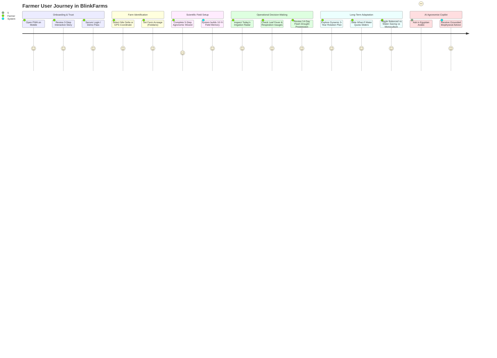

# BlinkFarms — Farmer-Centered UX Journey & Scientific Usability Architecture
**NASA Space Apps Challenge 2026 — Challenge 7: Field Shift**

---

## 1. UX Design Philosophy & Personas

Agricultural decision-support systems frequently fail in the field because they either oversimplify into toy recommendations or overwhelm farmers with scientific jargon ($WSI$, $ET_0$, $k_y$, $T_c - T_{air}$).

BlinkFarms bridges this gap through a **Dual-Layered Presentation Model**:
- **Layer 1: Farmer-First Actionable Interface**: Intuitive Egyptian Arabic vernacular, local units ($\text{م}^3 / \text{فدان}$), direct irrigation timing, color-coded physiological thermometers, and progressive disclosure.
- **Layer 2: Scientific Defensibility & Provenance**: One-tap transparency revealing exact NASA satellite instruments (ECOSTRESS TIR, SMAP L-band, NASA POWER MERRA-2), spatial resolutions, observation timestamps, and mathematical formulations.

### Target Personas

| Persona | Archetype | Primary Pain Point | BlinkFarms Solution |
| :--- | :--- | :--- | :--- |
| **Hajj Mahmoud** (Nile Delta, 15 Feddans) | Traditional Flood/Pivot Farmer | Monoculture yield decline, high synthetic nitrogen costs, unexpected heat spikes | 3-Year Adaptive Rotation with Berseem Clover; 14-day early warning before browning; water savings in $\text{m}^3/\text{feddan}$ |
| **Eng. Youssef** (Nubaria Desert Reclamation) | Commercial Desert Agro-Investor | High well-water salinity, sandy soil compaction (hardpan), acute summer heatwaves | Subsoil hardpan bio-drilling with deep taproots; halotolerant crop screening; real-time ECOSTRESS evaporative stress index |
| **Amina** (Agricultural Extension Officer) | Regional Agronomist | Translating complex satellite data to 500+ smallholder farmers | Deterministic TOPSIS multi-criteria tradeoffs; auditable NASA observation provenance; zero fabricated claims |

---

## 2. End-to-End User Journey Flow

---

## 3. Data Provenance & Transparency System

To eliminate "black-box" distrust, every metric in BlinkFarms displays an explicit **Provenance Badge**:

| Badge | Meaning | Typical Usage |
| :--- | :--- | :--- |
| `🟢 LIVE` | Direct, real-time sensor observation with verified timestamps | NASA POWER daily solar irradiance, air temperature, relative humidity |
| `🔵 HISTORICAL` | Empirical multi-year climatological observation archive | 30-year NASA POWER MERRA-2 baseline; 36-month SMAP root moisture record |
| `🟡 ESTIMATED` | Physically grounded biophysical estimation with stated assumptions | Crop evapotranspiration $ET_c$ via FAO-56 dual coefficient; regional soil profile proxy |
| `🟣 SIMULATED` | Forward-looking agronomic scenario or mathematical projection | 3-Year FieldShift TOPSIS rotation sequences; What-If deficit irrigation shocks |
| `👤 USER_INPUT` | Farmer-reported field ground truth | Soil texture, observed hardpan, previous crop, farm size in feddans |

---

## 4. Egyptian Farming Vernacular vs. Scientific Nomenclature

| Scientific Concept | Farmer-Friendly Arabic (BlinkFarms) | English Technical Term |
| :--- | :--- | :--- |
| $\text{Prescribed } I$ | **الري المطلوب اليوم (م³ / فدان)** | Daily Irrigation Depth ($mm \to m^3/ha$) |
| $T_c - T_{air} > +3^\circ\text{C}$ | **حرارة أوراق النبات (عطش وسخونة عروق)** | Canopy Thermal Anomaly / Vegetative Fever |
| $\text{ESI} = ET_a / PET$ | **تنفس وعرق النبات (كفاءة النتح)** | Evaporative Stress Index / Relative ET |
| $\xi_{\text{soil\_error}} < 0.70$ | **كتمة وانضغاط باطن الأرض (طبقة صماء)** | Subsoil Compaction / Plow Hardpan |
| $\text{Biomass Residue}$ | **حطب وقش المحصول لتغذية التربة** | Organic Residue Incorporation |
| $\text{Biological } N_2 \text{ Fixation}$ | **تثبيت الآزوت الحيوي مجاناً في الأرض** | Symbiotic Rhizobial Nitrogen Fixation |
| $\text{Deficit Irrigation}$ | **ري الترشيد والصمود المائي** | Regulated Deficit Irrigation ($RDI$) |

---

## 5. Mobile Ergonomics & PWA Execution
- **Thumb-Zone Navigation**: Primary navigation buttons positioned in the lower viewport for seamless single-handed mobile operation in the field.
- **Offline / Low-Connectivity Resilience**: Cached NASA POWER regional climatology tables and client-side TypeScript biophysical solver ensure zero disruption even in remote desert reclamation zones.
- **Haptic & Contrast Standards**: High-contrast typography conforming to WCAG AA, readable under direct Egyptian summer sunlight ($> 100,000\text{ lux}$).
